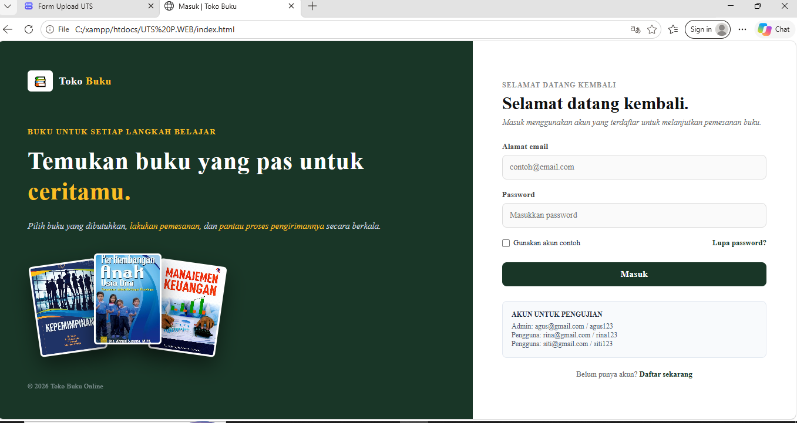
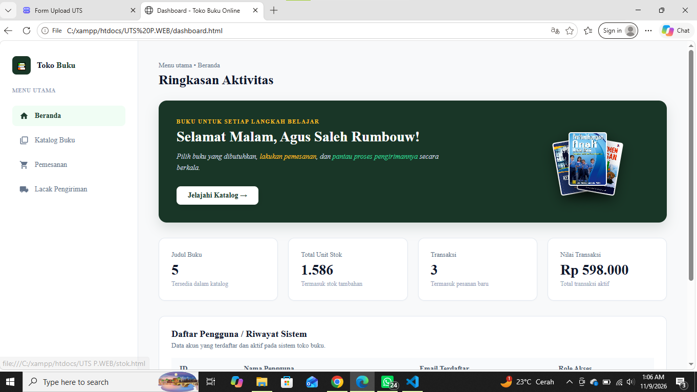
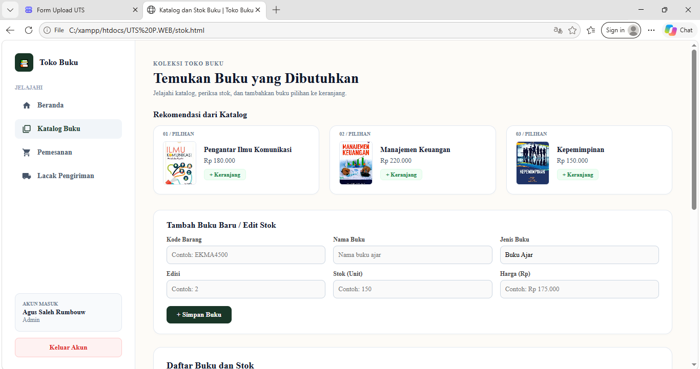
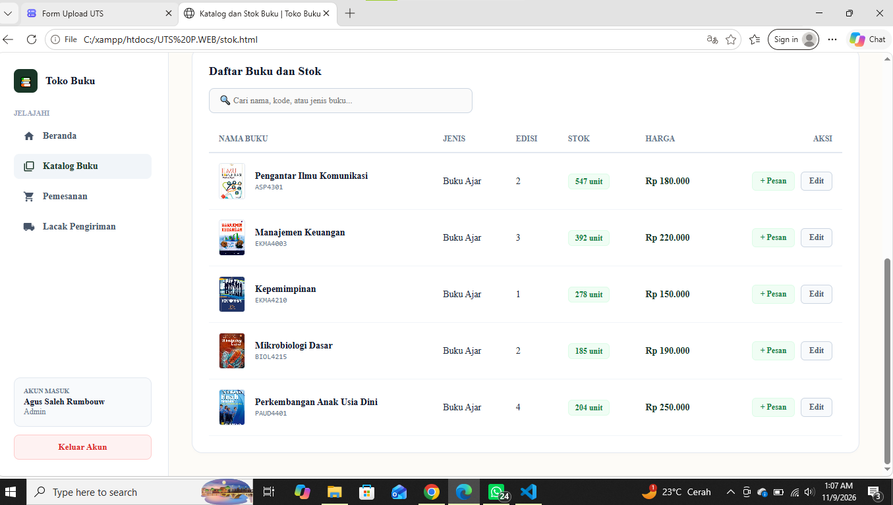
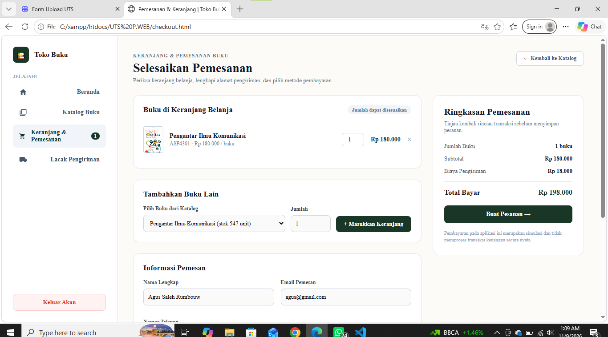
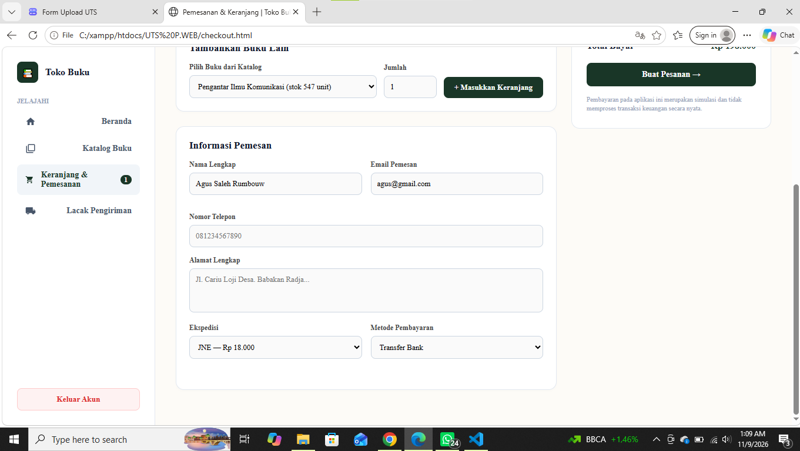
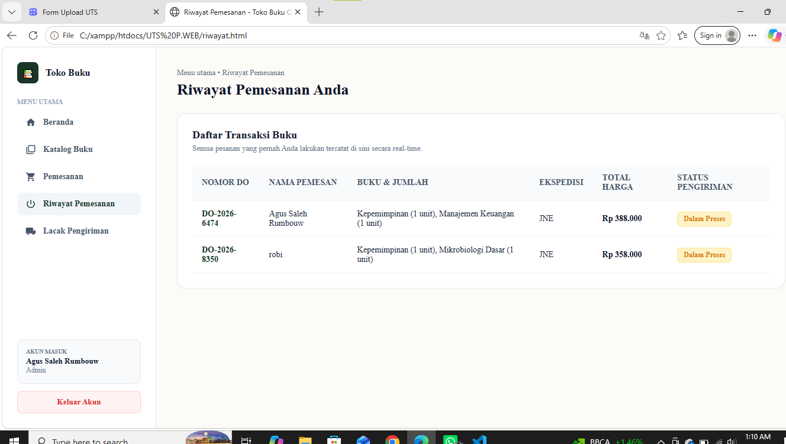
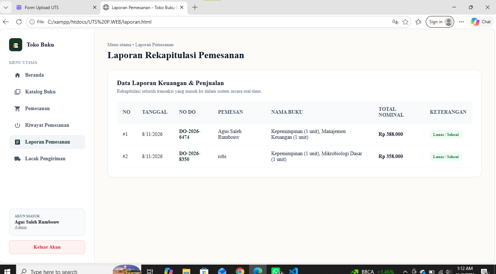
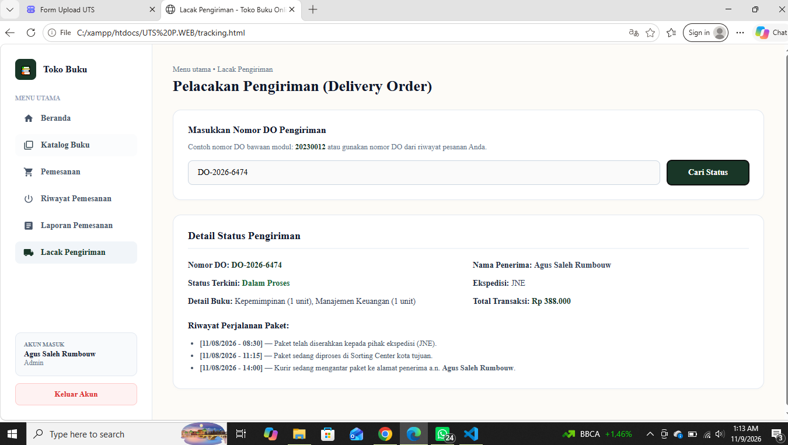

# Toko Buku Online (Frontend-Only Application)

Project **Toko Buku Online** adalah aplikasi web interaktif yang dikembangkan menggunakan arsitektur *client-side* murni, mencakup HTML5, CSS3, dan JavaScript, tanpa bergantung pada server *backend* maupun database eksternal. Seluruh fungsionalitas aplikasi—mulai dari manajemen sesi pengguna, data katalog, keranjang belanja, hingga pencatatan transaksi—sepenuhnya dikelola menggunakan penyimpanan lokal browser (*localStorage*), sehingga data tetap persisten di sisi klien meskipun halaman dimuat ulang.

---

## 1. Arsitektur & Teknologi
* **Bahasa Pemrograman:** HTML5, CSS3, JavaScript (ES6)
* **Styling / Desain:** CSS murni dengan pendekatan *layout* responsif, tipografi konsisten (*Times New Roman*), dan skema warna hijau estetis.
* **Manajemen State & Database Klien:** Browser `localStorage` (menggantikan database SQL/NoSQL).

---

## 2. Struktur & Penjelasan File / Menu Utama

### A. Halaman Autentikasi (`index.html`)
* **Fungsi:** Mengelola proses masuk (*login*) pengguna ke dalam sistem.
* **Fitur & Logika:**
  * Menerapkan antarmuka *split-screen* dengan tipografi Times New Roman.
  * Melakukan verifikasi kredensial berdasarkan array data akun terdaftar.
  * Menerapkan pembatasan hak akses (*Role-Based Access Control*), yang membedakan hak istimewa antara akun Admin dan pengguna biasa.
  * Validasi input dengan sistem peringatan dini (*alert*) jika email atau password tidak sesuai.

  <b>Gambar Halaman Login</b>
  

### B. Halaman Beranda / Dashboard (`dashboard.html`)

* **Fungsi:** Menjadi pusat informasi ringkasan aktivitas dan statistik operasional toko.
* **Fitur & Logika:**
  * Navigasi sidebar terpadu untuk perpindahan antar menu.
  * Banner sambutan dinamis yang menampilkan sapaan berdasarkan akun aktif serta elemen visual tumpukan buku estetik.
  * Grid statistik (*cards*) yang merangkum total judul buku, total unit stok, jumlah transaksi, dan nilai transaksi aktif secara *real-time*.
  * Tabel rekapitulasi akun dan riwayat sistem yang aktif.

### C. Halaman Katalog & Manajemen Stok (`stok.html`)

<i>Halaman Katalog untuk admin</i>

<i>Halaman Katalog User</i>

* **Fungsi:** Menampilkan daftar koleksi buku, rekomendasi pilihan, serta pengelolaan stok.
* **Fitur & Logika:**
  * Kotak pencarian instan untuk memfilter data buku berdasarkan nama, kode, atau kategori.
  * Tampilan tabel stok interaktif dengan tombol aksi cepat.
  * **Kontrol Akses Dinamis:** Akun dengan hak akses Admin dapat melihat formulir tambah/edit serta tombol penyuntingan data untuk melakukan operasi CRUD (*Create, Read, Update*), sementara akun pengguna biasa hanya dapat menelusuri produk dan melakukan pemesanan.

### D. Halaman Keranjang & Pemesanan (`checkout.html`)

* **Fungsi:** Mengelola daftar belanja dan proses *checkout* transaksi pemesanan buku.
* **Fitur & Logika:**
  * Indikator badge keranjang belanja secara *real-time* di sidebar.
  * Manajemen item keranjang yang memuat thumbnail cover buku, judul, penyesuaian kuantitas (*qty*), serta tombol hapus.
  * Integrasi *dropdown* pilihan buku dari katalog untuk menambah item secara instan.
  * Formulir data pengiriman lengkap dengan pilihan ekspedisi (JNE, J&T, SiCepat) dan metode pembayaran.
  * Kalkulasi total bayar otomatis (subtotal + ongkir) dan pembuatan nomor *Delivery Order* (DO) unik saat transaksi diselesaikan.

### E. Halaman Riwayat Pemesanan (`riwayat.html`)
* **Fungsi:** Menyediakan catatan riwayat transaksi yang pernah dilakukan oleh pengguna.
* **Fitur & Logika:**
  * Memuat data transaksi secara otomatis dari `localStorage` yang disinkronkan dari halaman *checkout*.
  * Menampilkan informasi Nomor DO, nama pemesan, rincian buku, ekspedisi, total harga, serta status pengiriman interaktif.

### F. Halaman Laporan Pemesanan (`laporan.html`)
<i>Gambar Riwayat Pemesanan</i>

<i>Gambar Laporan Pemesanan</i>

* **Fungsi:** Menyajikan rekapitulasi data keuangan dan penjualan secara menyeluruh.
* **Fitur & Logika:**
  * Tabel rekapitulasi transaksi yang mencakup tanggal, nomor DO, identitas pemesan, rincian buku, total nominal, dan status keterangan pelunasan.
  * Sinkronisasi data otomatis setiap kali transaksi baru diselesaikan.

### G. Halaman Lacak Pengiriman (`tracking.html`)

* **Fungsi:** Memantau status logistik pengiriman paket berdasarkan nomor *Delivery Order* (DO).
* **Fitur & Logika:**
  * Input pencarian nomor DO (mendukung nomor bawaan modul maupun nomor DO unik hasil transaksi baru).
  * Validasi data transparan yang menampilkan nama penerima, status terkini, kurir, rincian produk, total transaksi, hingga rekam jejak perjalanan paket.